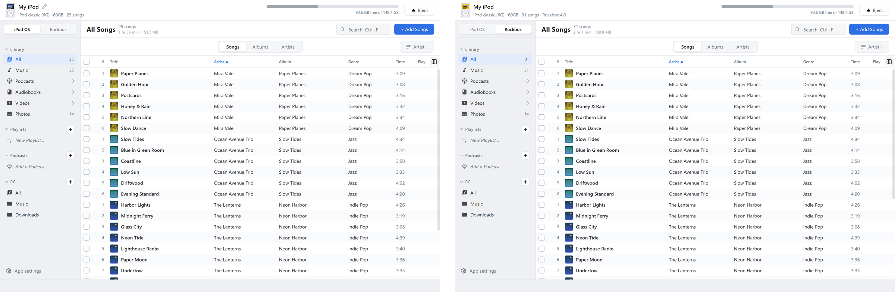

# ZenPod: iPod classic Manager for iPod OS & Rockbox

**Manage your iPod classic — with the stock iPod OS or with Rockbox.**

A music manager for iPods that supports both iPod OS (Apple's firmware) and Rockbox. 
Drag and drop songs onto your iPod, and tidy up the music files on your PC too. No iTunes needed.

For Windows, macOS and Linux. **Completely free** — no ads, no paid features, no account needed

[**Website**](https://ishiichan-dayo.github.io/ZenPod/en/) · [**Download**](https://github.com/ishiichan-dayo/ZenPod/releases/latest) · [日本語](README.md)

https://github.com/user-attachments/assets/2299ad84-81b5-4767-9473-17d8b059194f

---

## Highlights

- **Works with both iPod OS and Rockbox**: switch with "iPod OS | Rockbox" at the top left. On a dual-boot iPod with Rockbox, keep songs for both on one iPod
- **Just drop to transfer**: FLAC, Ogg, Opus and others are converted automatically for iPod OS (and go over as-is to Rockbox). Artwork and lyrics come along too
- **The Rockbox database, built on your PC**: eject and browse "Database" right away
- **Tidy up your PC library**: edit tags, look up song info and artwork online, rename files in bulk
- **Podcasts, videos, photos and smart playlists** are supported too

Details, screenshots and the FAQ are on the **[website](https://ishiichan-dayo.github.io/ZenPod/en/)**.

## Supported iPods

| Model | iPod OS | Rockbox |
| --- | --- | --- |
| iPod classic 6G / 6.5G / 7G (80 / 120 / 160 GB) | Yes | Yes |
| iPod video 5G / 5.5G | Yes | Yes |
| iPod nano 3G / 4G | Yes | No |
| iPod photo, iPod nano 1G / 2G | Yes | Yes |
| iPod 1G–4G (monochrome), iPod mini 1G / 2G | Yes (music only — the screen can't show artwork) | Yes |
| iPod nano 5G and later, iPod touch | No (read-only) | No |
| iPod shuffle | No | No |

- Rockbox mode works on iPods with Rockbox 4.0 or later installed. It has been tested on a real iPod classic. To install Rockbox, use Rockbox Utility from the [official Rockbox site](https://www.rockbox.org/) (this app doesn't install Rockbox itself or its bootloader)
- iPods modded with iFlash or other SD adapters work just like stock ones
- **On Windows, the iPod must be Windows-formatted (FAT32).** Mac-formatted (HFS+) iPods can't be read by Windows — restore it in iTunes to reformat it for Windows. On macOS, both formats work. On Linux, Windows format (FAT32) is recommended
- iPod 1G / 2G connect over FireWire only, so you'll need an adapter for modern PCs

## Download

Get the file for your OS from the [latest release](https://github.com/ishiichan-dayo/ZenPod/releases/latest) (or straight from the [website](https://ishiichan-dayo.github.io/ZenPod/en/#download)).

| OS | File |
| --- | --- |
| Windows 10 / 11 (64-bit) | `ZenPod_x.y.z_x64-setup.exe` |
| macOS (Intel / Apple Silicon) | `ZenPod_x.y.z_universal.dmg` |
| Linux (x86_64, experimental) | `ZenPod_x.y.z_amd64.AppImage` (or `.deb` for Debian / Ubuntu) |

Once installed, the app lets you know when a new version is available. Converting FLAC and other formats in iPod OS mode requires ffmpeg (one click to install from the app on Windows and macOS).

### First launch

The app isn't code-signed yet, so you'll see a warning the first time.

- **Windows**: if you see "Windows protected your PC", click "More info" → "Run anyway"
- **macOS 15 (Sequoia) or later**: try opening the app once and close the warning, then go to System Settings → Privacy & Security, scroll down, and click "Open Anyway" (enter your password if asked)
- **macOS 14 or earlier**: right-click the app in Finder → "Open"
- **Linux (AppImage)**: make the file executable before opening it (`chmod +x ZenPod_*.AppImage`)

## Safety

- iPod OS: the first time an iPod is opened, its original database is saved as `iPod_Control/iTunes/iTunesDB.zenpod-backup`. If anything goes wrong, copy it back to `iTunesDB` to restore
- Rockbox: before the database is rebuilt for the first time, the original database is saved in `.rockbox/zenpod-db-backup/`. If something doesn't look right, you can also rebuild it on the iPod with "Database → Update Now"
- Databases are written to a temporary file first and then swapped in, so an interrupted write is unlikely to corrupt them
- If iTunes / Music.app is set to sync automatically, it may remove songs added with this app. Set it to "Manually manage music"
- The app only goes online for artwork / song info / artist alias searches, fetching podcast feeds and episodes, installing ffmpeg, checking for updates, and sending anonymous usage data (searches send the artist and album name to each service)
- Anonymous usage data: to improve the app, once a day it sends only the app version, language, OS, the mode (iPod OS / Rockbox) and model of the iPod you open, a rough range of its song count, how long it took to open and where that time went, what you chose in the welcome guide (whether you installed ffmpeg and whether you use Rockbox), whether a connected iPod didn't show up as a drive or no iPod was opened for a while, how transfers went (whether they succeeded, and rough ranges of the song and error counts), how far you got with the online lookups (whether you searched and applied a result, rough ranges of the number of results and the time taken, and which service the chosen result came from), and how installing ffmpeg from Settings went, to a server in Japan run by the developer. No personal information such as names, file locations, song titles, or iPod names or serial numbers is sent, and IP addresses are not stored. You can turn it off at any time in Settings → About

## Limitations

- In iPod OS mode, photos are stored only as images resized for the iPod's screen (the original full-size images aren't copied)
- To install Rockbox itself, its bootloader or themes, use the official Rockbox Utility

## Bug reports and requests

Please use [Issues](https://github.com/ishiichan-dayo/ZenPod/issues). Including your iPod model (shown at the top left of the window), the mode (iPod OS / Rockbox) and your OS helps a lot.

## Support

ZenPod is a free app made by one person. If you find it useful, you can [buy me a coffee on Ko-fi](https://ko-fi.com/ishiichan_dayo). It helps keep development going.

---

iPod and iTunes are trademarks of Apple Inc. This software is not affiliated with Apple or the Rockbox project.
