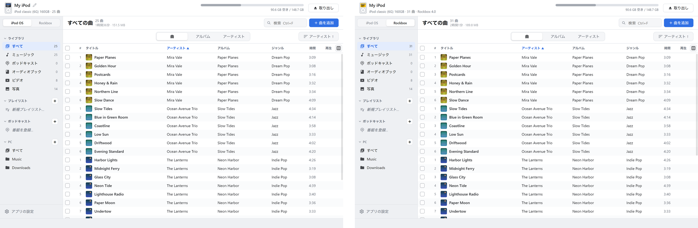

# ZenPod：iPod OS と Rockbox に対応した iPod classic 管理アプリ

**iPod classic の曲を、純正の iPod OS でも Rockbox でも。**

iPod OS（Apple のファームウェア）と Rockbox の両方に対応した、iPod のための音楽管理アプリ。 
ドラッグ＆ドロップで曲を入れられて、PC の音楽ファイルの整理にも使えます。iTunes はいりません。

Windows / macOS / Linux 用。**完全無料**（広告なし・有料機能なし・アカウント登録不要）

[**サイト**](https://ishiichan-dayo.github.io/ZenPod/) ・ [**ダウンロード**](https://github.com/ishiichan-dayo/ZenPod/releases/latest) ・ [English](README.en.md)

https://github.com/user-attachments/assets/ec41166c-ef58-4174-b428-4b8eb114418e

---

## 主な機能

- **iPod OS と Rockbox の両方に対応**：左上の「iPod OS | Rockbox」で切り替え。Rockbox を入れた iPod なら、両方の曲を 1 台に入れて使い分けられます
- **ドロップするだけで転送**：FLAC・Ogg・Opus などは iPod OS 用に自動で変換（Rockbox にはそのまま）。アートワーク・歌詞も一緒に
- **Rockbox のデータベースを PC で作成**：取り出せばすぐ「データベース」から曲を探せます
- **日本語の曲がちゃんと並ぶ**：転送するときに読みを自動で付けます（辞書は内蔵）
- **PC の音楽ファイルの整理**：タグの編集、曲情報とアートワークのネット検索、ファイル名の一括変更
- **ポッドキャスト・動画・写真・スマートプレイリスト**にも対応

機能の詳しい説明・画面・よくある質問は **[サイト](https://ishiichan-dayo.github.io/ZenPod/)** にあります。

## 対応機種

| 機種 | iPod OS | Rockbox |
| --- | --- | --- |
| iPod classic 6G / 6.5G / 7G（80・120・160GB） | ○ | ○ |
| iPod video 5G / 5.5G | ○ | ○ |
| iPod nano 3G / 4G | ○ | × |
| iPod photo・iPod nano 1G / 2G | ○ | ○ |
| iPod 1G〜4G（白黒液晶）・iPod mini 1G / 2G | ○（画面がアートワーク非対応のため曲のみ） | ○ |
| iPod nano 5G 以降・iPod touch | ×（読み取りのみ） | × |
| iPod shuffle | × | × |

- Rockbox モードは、iPod に Rockbox（4.0 以降）が入っていれば使えます。実機での確認は iPod classic で行っています。Rockbox の入れ方は [Rockbox 公式サイト](https://www.rockbox.org/) の Rockbox Utility を使ってください（このアプリは Rockbox 本体やブートローダーは入れません）
- iFlash などで SD カードに換装した iPod も、普通の iPod と同じように使えます
- **Windows では Windows 形式（FAT32）の iPod が必要です。** Mac 形式（HFS+）の iPod は Windows から読めないため、iTunes で「復元」して Windows 形式に初期化してください。macOS ではどちらの形式でも使えます。Linux では Windows 形式（FAT32）をおすすめします
- iPod 1G / 2G は FireWire 接続のため、今の PC につなぐには別の機器が必要です

## ダウンロード

[最新版のリリース](https://github.com/ishiichan-dayo/ZenPod/releases/latest) から、お使いの OS 用のファイルをダウンロードしてください（[サイト](https://ishiichan-dayo.github.io/ZenPod/#download) からも直接ダウンロードできます）。

| OS | ファイル |
| --- | --- |
| Windows 10 / 11（64 bit） | `ZenPod_x.y.z_x64-setup.exe` |
| macOS（Intel / Apple Silicon） | `ZenPod_x.y.z_universal.dmg` |
| Linux（x86_64、試験的） | `ZenPod_x.y.z_amd64.AppImage`（Debian / Ubuntu は `.deb` も可） |

一度インストールすれば、以降はアプリが新しいバージョンを知らせてくれます。iPod OS モードで FLAC などを変換するには ffmpeg が必要です（Windows / macOS はアプリからワンクリックで入れられます）。

### 初回起動時の注意

アプリにはまだコード署名をしていないため、初回だけ警告が出ます。

- **Windows**：「Windows によって PC が保護されました」と表示されたら「詳細情報」→「実行」
- **macOS 15（Sequoia）以降**：一度アプリを開いて警告を閉じたあと、「システム設定」→「プライバシーとセキュリティ」の下のほうにある「このまま開く」を押す（パスワードを求められたら入力）
- **macOS 14 以前**：Finder でアプリを右クリック →「開く」
- **Linux（AppImage）**：ファイルに実行の許可を付けてから開く（`chmod +x ZenPod_*.AppImage`）

## 安心して使うために

- iPod OS：初めて開いた iPod の元のデータベースを `iPod_Control/iTunes/iTunesDB.zenpod-backup` に残します。困ったときはこれを `iTunesDB` に戻せば元どおりです
- Rockbox：初めてデータベースを作り直す前に、元のデータベースを `.rockbox/zenpod-db-backup/` に残します。うまく動かないときは、本体の「データベース → 今すぐ更新」でも作り直せます
- データベースは一時ファイルに書いてから置き換えるので、書き込みの途中で止まっても壊れにくくしています
- iTunes / ミュージック.app の「自動同期」が有効だと、このアプリで入れた曲が消されることがあります。iTunes 側は「手動で管理」にしてください
- ネットに接続するのは、アートワーク・曲情報・アーティストの別名のネット検索、ポッドキャストのフィードと回の取得、ffmpeg の導入、更新の確認、匿名の利用状況の送信のときだけです（検索ではアーティスト名・アルバム名を各サービスに送ります）
- 匿名の利用状況：アプリの改善のため、1 日 1 回、アプリのバージョン・言語・OS、開いた iPod のモード（iPod OS / Rockbox）・機種・曲数のおおまかな範囲・開くのにかかった時間とその内訳、はじめの案内で選んだこと（ffmpeg を入れたか・Rockbox を使っているか）、iPod をつないでもドライブとして表示されなかったことや iPod を開かないまま時間がたったこと、転送の結果（成功したか・曲数とエラーの数のおおまかな範囲）、ネットで探す機能をどこまで使ったか（検索したか・反映したか・候補の数とかかった時間のおおまかな範囲・どのサービスの候補を選んだか）、設定から ffmpeg を入れた結果だけを、開発者が管理する日本のサーバーに送ります。名前・ファイルの場所・曲名・iPod の名前やシリアル番号などの個人情報は送らず、IP アドレスも保存しません。設定の「このアプリについて」でいつでもオフにできます

## 制限事項

- iPod OS の写真は、iPod の画面に合わせて縮小した画像だけを置きます（元の大きさの画像は置きません）
- Rockbox 本体・ブートローダー・テーマの導入は、Rockbox 公式の Rockbox Utility を使ってください

## 不具合の報告・要望

[Issues](https://github.com/ishiichan-dayo/ZenPod/issues) にお寄せください。iPod の機種（画面の左上に表示されます）・モード（iPod OS / Rockbox）・OS を書いていただけると助かります。

## 応援

ZenPod は個人で開発している無料のアプリです。気に入っていただけたら、[Ko-fi](https://ko-fi.com/ishiichan_dayo) で応援していただけるとうれしいです。開発を続ける励みになります。

---

iPod・iTunes は Apple Inc. の商標です。このソフトウェアは Apple とも Rockbox プロジェクトとも関係ありません。
